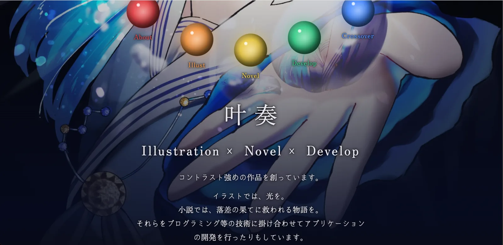
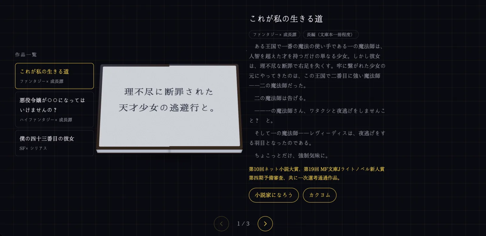

<!--
  このファイルは公開されます（GitHub と、サイトの /drafts/making/homepage.md）。本名・住所などは書かないでください。
  Claude が、このファイルを元に dev/homepage.html を作ります。文章の言い回しは変えません。
  ・「## 見出し」1つが、ページの1節と、左の目次の1項目になります。見出しは、足しても消しても、順番を変えてもかまいません。
  ・【】の部分は、書き換えるか、消してください。【】が残っていたら、Claude が確認します。
  ・先に書いてある文は、コミット履歴とコードから分かる事実です。言い回しは自由に直してください。
  ・画像・動画は  と書きます。新しい画像・動画の元のファイルは、リポジトリの外（HomePage-assets/originals/ など）に置いてください（縮小と、付属情報の削除は Claude がします）。
    サイトにある画像は ../../images/... と書けば、VS Code のプレビューでも見えます。
  ・先頭を「---」で始めないでください（GitHub Pages が、ページに変換してしまうため）。
-->

# 叶奏の備忘録

私、叶奏（かないかなで）が創った作品をまとめるためのHP。私ではない誰かに見てもらう時に見やすいよう、という目的もあるが、私個人が見返すことが出来るようにも、という目的もあります。

## 作ろうと思ったきっかけ

個人HPを作ろうと思ったきっかけは、とあるハッカソンに応募する際に必要となったから。以前知り合いからGitHub Pagesのことは聞いており、せっかく良い機会だからと、それを用いて公開まですることにしました。

## コンセプト

前提として、どんな作品を作っていて、どんな傾向の作品を作ることが出来るのかについてがわかることは目指しています。
ただ、せっかく作るのであればただ作品を並べるだけではつまらないだろうと考え、各作品ジャンルごとに違う演出で一覧として見れるようにするなどといった、見る人を飽きさせないことも目標としています。
追加で、創作×開発をテーマにしたページを作成するなど、私の持っている能力の見せ方にもこだわっています。

## デザイン

黒を基調にして、ページごとに差し色を変えています（About は赤、Illust は橙、Novel は黄、Develop は緑、Crossover は青）。トップの5色の玉が、そのまま各ページへの入り口になっています。
玉の色については、虹色を念頭に置きつつ選択しました。
個数としては気持ちのよい5個を選択しています。
これは個人的な考えなのですが、何かしらを列挙する際には2、3、5、7、10あたりを選ぶと良いのではないか？　と考えています。よく講座系の動画であるのが『◯◯を××する3つの方法』であったり、以前好きな小説で例示をしている個数を数えたら7個だったりしているので、それなりに通説に近しいのではないかと、勝手に思ったりもしています。
フォントは、かなにKokoro、漢字と英数字にZen Old Minchoを使っています。
こころ明朝体、どことない優しさがあって好きなフォントです。よくコミケの冊子を作る際にも使っています（ゴシック体より明朝体のほうが好みというのもありますが）。おすすめです。

## 各ページの演出

Top画面では、最初にHPに訪れた人にはタイムラプス動画が、テレビの映りが乱れるように始まり、暗転してメニューに切り替わるようにしています。
イラストのメイキングって見ていて楽しいので、それがストレスに感じない程度の長さで流れてくれれば良いなという思いから、このような演出にしています。
また、イラスト・小説のうち、視認性のよいイラストのうち、名刺等にも使えるようコントラストばちばちかつ私の世界観を詰め込んだイラストを配置することで、私という存在をパッと見でわかるようにしています。良いですよね、このイラスト。ものすごく眩しくて。
Illustのページでは、上部に作品を展示するようなイメージを目指した、お気に入りの作品を掲示するところと、これまでに描いてきたオリジナル作品を一覧で見ることのできるGalleryを載せています。
Novelでは、本の表紙が開き、作品を切り替えるとページがめくれます。作品一覧については左側（もしくは左上部にある3本線を押すと出てくるタブ的なやつ）が兼ねています。そこにジャンルも一緒に載せることで、パッと見でどんな作品を書いているのかがわかるようにしています。
Developでは、サイバー風の演出を目指して作成しています。

## 作成方法

Claude Codeと一緒に、バイブコーディングで作りました。2026年10月22日に作り始め、約4日ほどでとりあえず見せれるかな？　という形にはなりました。
ビルドやフレームワークは使わず、HTML・CSSと少しのJavaScriptだけで作り、GitHub Pagesで公開しています。
プログラミング自体はこのHPを作り始めた段階から数えて5年半ほどやっていて、うちC言語とPythonをメインで使用しています。コードを読むこと自体にはそこそこ自信があるため、他言語であっても大体の意味は理解でき……ます。
そんな中、バイブコーディングに手を出し始めたのは、これまた同じくこのHPを作り始めた段階から数えると2、3ヶ月ほど前のことで。今ではすっかりお世話になっています。
現在メインで使っているのはClaude、或いはClaude CodeのOpusとSonnetです。使っているツールが優秀ということもあり（もしくは私のプロンプトの投げ方が良いのかもしれないですが！）、ほぼイメージ通りのものを出力してくれていて、これまで手戻りを経験したことはほぼありません。1回だけ、このHPを作る際の配置で3度ほどやり直しになる、という事象がありました。その時はとても眠くて頭がぼんやりしていた思い出があるため、~~やはり普段のプロンプトが良いため手戻りが発生していないのかもしれないです~~。
先述の通り、あまり触ったことのないような言語でもコードは読めるので、時折手作業で細かい調整をすることもあります。本HPだと、Topページの上部にある『叶奏の備忘録』の文字を読みやすくするために、文字とイラストの間に黒いグラデーションを透明度下げて入れているのですが、その透明度の調整もそのひとつです。
バイブコーディングをする際の個人的なコツとしては、完成のイメージを固め切ってから、可能であればそれを作るための手段も含めプロンプトとして投げることです。特に完成イメージについては、手描きなどをし、画像として投げてしまうのもありです。というか私はよくそうしています。かなりラフい画像でもちゃんとイメージが書かれていれば今のAIは読み取ってくれるので、まだやったことのない方は試してみてください。
あとは、これはあまり一般的な考え方なのかどうかはわからないのですが、私は生成AIへのプロンプトを他人にもの伝える時と同じだと考えています。他人に何かをお願いする時、『いい感じに作っといて』とか『うまいこと作って』とか言ってもいいものなんてできやしないわけで。ちゃんと、こちらの脳内にあるイメージを言語化して、相手に伝わる言語・言葉遣いで見える化しないことには伝わらないはずです。それは、どれだけ仲の良い相手に対しても同じだと思います。
そしてそれは生成AIにプロンプトを投げる時も当てはまるのではないかということです。何を作りたいのか、そのためにどうすれば良いと考えているのか、どうすれば上手く出来るのかがわからないなら相談という形で。必要なら、作り始める前のプランを立てる段階で意見のすり合わせをして。
あとは、人間だって間違えることは当然あるのだから、生成AIだって同じく間違えることくらいあるという心持ちでいるのも、コツのひとつなのかもしれません。

## 苦労したこと

誰かに公開する前提で開発をしたことが初めてだったため、UI/UXを考える際に少々手間取ったりしていました。そのため、第三者の意見をもらい進めました。客観的な意見をもらうことは創作では非常に大事なこと（創作に限らず研究などでもそうだとは思いますが）です。少なくとも私はそう考えています。
あとは、Top画面の演出や見え方、Developの演出を調整することに苦労しました。細かい調整の積み重ねが全体のクオリティを底上げするので、今後も細かい修正は重ねていく予定です。

## これから

まずはDevelopとCrossoverに掲載している、近日公開予定を片付けたいところです。
他にも、新規作品を創ったら適宜HPを更新していきたいと思います。

## 更新日
2026/11/05
